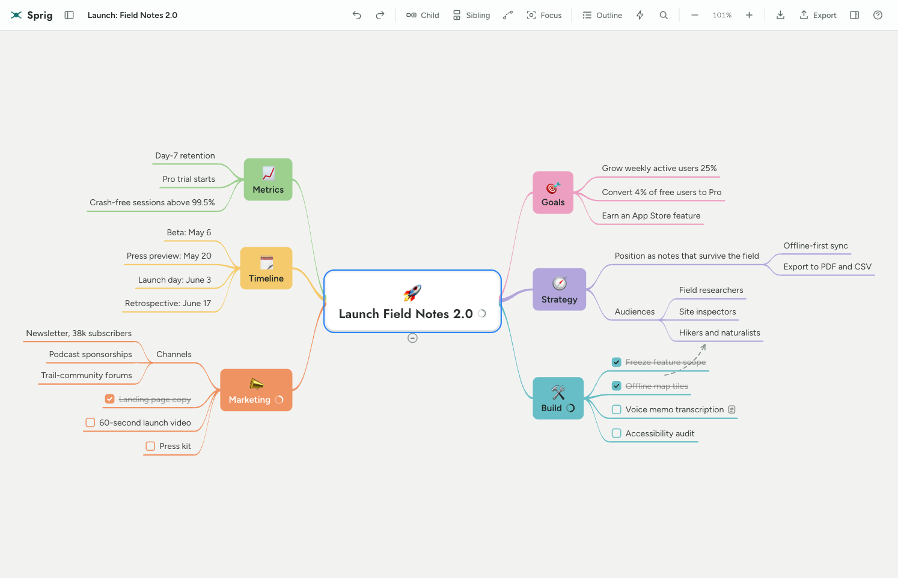
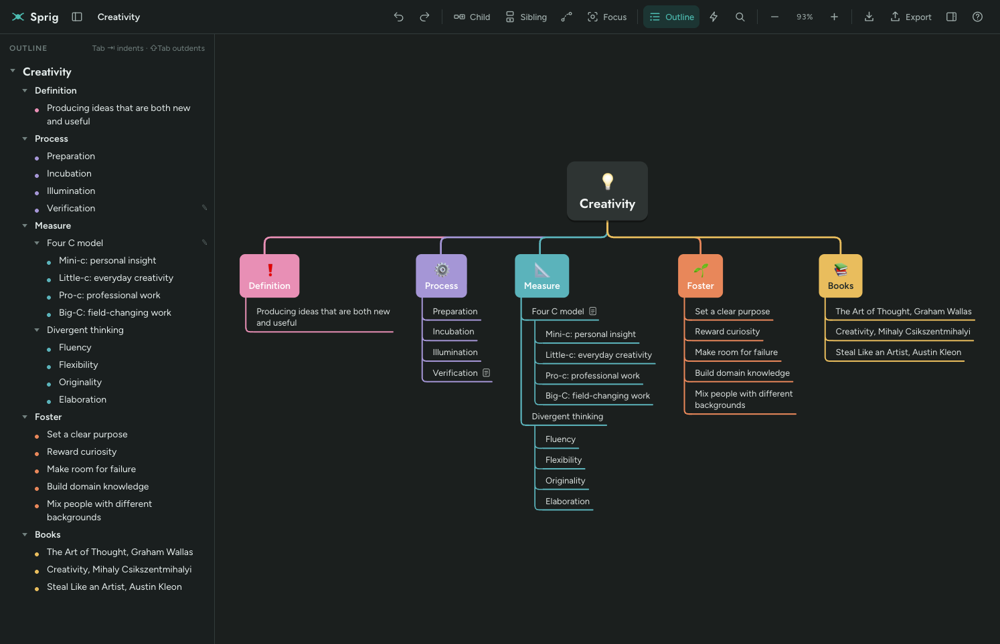

# Sprig

A mind-mapping app for the browser, modelled on [MindNode](https://www.mindnode.com) for macOS. Sprig is a single HTML file with no build step, no dependencies to install and no server-side code. Open it and start mapping.





---

## Contents

- [Quick start](#quick-start)
- [Features](#features)
- [Using Sprig](#using-sprig)
- [Keyboard shortcuts](#keyboard-shortcuts)
- [Import and export](#import-and-export)
- [Moving maps over from MindNode](#moving-maps-over-from-mindnode)
- [Where your maps are stored](#where-your-maps-are-stored)
- [How it works](#how-it-works)
- [Browser support](#browser-support)
- [Known limitations](#known-limitations)
- [Contributing](#contributing)
- [License](#license)

---

## Quick start

You only need a modern web browser. Python or Node.js is optional and only used to serve the file locally.

### 1. Get the code

```bash
git clone https://github.com/skarlekar/sprig.git
cd sprig
```

### 2. Start the app

Pick one of these options.

**Option A: open the file directly (simplest)**

```bash
open index.html            # macOS
xdg-open index.html        # Linux
start index.html           # Windows
```

Or double-click `index.html` in your file manager. This works in Chrome, Edge and Safari.

**Option B: serve it locally (recommended)**

A local web server gives the app a stable origin, so your saved maps persist reliably in every browser, including Firefox.

With Python 3 (installed on macOS and most Linux systems):

```bash
python3 -m http.server 8000
```

With Node.js:

```bash
npx serve .
```

Then open <http://localhost:8000> (Python) or the URL that `serve` prints (Node).

To stop the server, press `Ctrl+C` in the terminal.

### 3. Try it

On first launch Sprig loads three example maps: **Launch: Field Notes 2.0**, **Creativity** and **Dinner Party**. Click any node, press `Tab` to add a child, type, and press `Return`. Open the **Documents** panel (the sidebar icon next to the logo) to switch maps or start a new one.

> Fonts (Jost and Figtree) load from Google Fonts. Offline, Sprig falls back to your system fonts and everything else keeps working.

---

## Features

**Mapping**
- Infinite canvas with smooth pan (scroll or drag) and zoom (pinch, `⌘` + scroll, or the toolbar).
- Three layouts: **Mind map** (branches balanced on both sides), **Right** (all branches on one side) and **Tree** (top-down columns with indented lists).
- Tapered curved branches or angled branches, colored per first-level branch.
- Several main nodes per map: double-click empty canvas to add one.
- **Cross connections**: dashed arrows linking ideas in different branches.
- A **+** button appears when you hover over a node, so you can grow the map with the mouse alone.
- Drag and drop to nest a node, reorder it, or detach it as a new main node.
- Fold and unfold branches. A folded branch shows how many nodes it hides.

**Content**
- **Tasks**: turn any node into a checkbox. Parent nodes show a progress ring for the tasks below them.
- **Notes**: attach longer text to any node. A small page icon marks nodes with notes.
- **Stickers**: 48 emoji stickers. Main and first-level nodes show them large above the text.
- Bold, italic, per-branch colors and node shapes (box, pill, underline).

**Working with ideas**
- **Outline**: a live, editable outline next to the map that stays in sync with it.
- **Quick Entry**: type or paste an indented list and turn it into a map in one step.
- **Focus mode**: dims everything except the selected branch.
- **Find**: searches node text and notes, unfolds hidden matches and jumps to each one.
- Undo and redo, up to 300 steps per session.
- Copy, cut and paste branches. Pasting plain text from anywhere creates nodes.

**Looks**
- Five themes: **Meadow**, **Harbor**, **Ember**, **Ink** and **Blueprint**. Each has a light and a dark version that follows your system setting.
- Responsive layout that works on tablets and phones, with touch panning and pinch zoom.

**Files**
- Export to PNG (2×), SVG, Markdown, OPML, plain text outline and Sprig JSON.
- Import OPML, Markdown, plain text and Sprig JSON, from the Import button or by dragging a file onto the canvas.
- Maps save automatically as you work.

---

## Using Sprig

### The toolbar

| Button | What it does |
|---|---|
| Sidebar icon | Show the Documents panel: switch maps, create a new map, delete a map |
| Title field | Rename the current map |
| Undo / Redo | Step backward and forward through changes |
| Child / Sibling | Add a node below or next to the selected node |
| Connection icon | Start a cross connection from the selected node, then click the target |
| Focus | Spotlight the selected branch |
| Outline | Show the editable outline |
| Lightning bolt | Open Quick Entry |
| Magnifier | Find in the map |
| − / % / + | Zoom out, fit the map to the window, zoom in |
| Import / Export | Load a file, or save the map in another format |
| Panel icon | Show the Inspector |
| ? | Show keyboard shortcuts |

### Editing nodes

- **Select** a node by clicking it, and **edit** it by double-clicking, pressing `Space`, or just typing.
- **Add nodes with the mouse:** hover over a node (or select it) and a round **+** button appears just past its outer edge. Click it to add a child, or `Shift`-click it to add a sibling. The new node opens for typing right away.
- While editing, `Return` finishes, `Shift+Return` adds a line break, and `Tab` finishes and adds a child.
- Press `Backspace` on a selected node (not while editing) to delete it and its branch.

### The Inspector

Open it with the panel icon or `⌘I`. With a node selected you can:

- Toggle **bold** and **italic**, or make the node a **task**.
- Change the **shape**: Auto, Box, Pill or Line (underline).
- Set a **branch color**. The color flows down to all of the node's descendants unless a child sets its own.
- Add or remove a **sticker**.
- Write a **note**.

For the whole map you can choose the **theme**, **layout** and **branch style**, fold or unfold everything, and see counts of nodes, tasks done, main nodes and cross connections.

### Quick Entry

Open it with the lightning-bolt button or `⌘E`. Type one idea per line and indent with `Tab` (or spaces) to nest ideas:

```
Trip to Lisbon
	Before we go
		[ ] Book flights
		[x] Renew passport
	Days
		Belém
		Sintra day trip
```

Choose **New map** or **Under selected node**, then click **Create map** (or press `⌘Return`). Quick Entry understands:

- Indentation with tabs or spaces
- Bullets: `-`, `*`, `+`, `•`, `1.`, `1)`
- Markdown headings: `#`, `##`, … (each level nests under the one before)
- Tasks: `[ ]` for open, `[x]` for done

### The outline

Open it with the Outline button or `⌘2`. It mirrors the map and you can edit it directly:

| Key | Action |
|---|---|
| `Return` | New item below |
| `Tab` / `Shift+Tab` | Indent / outdent |
| `Backspace` on an empty item | Delete it |
| `↑` / `↓` | Move between items |
| `Esc` | Return to the map |

Click the triangles to fold branches and the checkboxes to complete tasks.

### Drag and drop

Drag any node that isn't a main node:

- **Onto the middle of another node** to make it a child.
- **Near the top or bottom edge of a node** to place it before or after that node.
- **Onto empty canvas** to detach it as a new main node.

Drag a main node to move the whole map.

---

## Keyboard shortcuts

On Windows and Linux, use `Ctrl` where the table says `⌘`.

| Shortcut | Action |
|---|---|
| `Tab` | Add a child node |
| `Return` | Add a sibling node |
| `Space`, `F2` or start typing | Edit the selected node |
| `Shift+Return` | New line while editing |
| `←` `→` `↑` `↓` | Move between nodes |
| `⌘↑` / `⌘↓` | Move the node up or down among its siblings |
| `Backspace` / `Delete` | Delete the selected node or cross connection |
| `⌘/` | Fold or unfold the selected branch |
| `⌘D` | Turn a node into a task, check it off, then remove the task |
| `⌘B` | Bold |
| `⌘L` | Start a cross connection |
| `⇧⌘F` | Focus mode |
| `⌘F` | Find (`Return` and `Shift+Return` step through matches) |
| `⌘E` | Quick Entry |
| `⌘2` | Toggle the outline |
| `⌘I` | Toggle the Inspector |
| `⌘C` / `⌘X` / `⌘V` | Copy, cut and paste branches |
| `⌘Z` / `⇧⌘Z` | Undo / redo |
| `⌘0` | Fit the map to the window |
| `⌘+` / `⌘−` | Zoom in / out |
| `Esc` | Leave connect mode, focus mode or Find |
| `?` | Show the shortcut list |

---

## Import and export

| Format | Export | Import | Keeps |
|---|:-:|:-:|---|
| **Sprig JSON** (`.sprig.json`) | ✓ | ✓ | Everything: layout, theme, colors, shapes, stickers, tasks, notes, cross connections |
| **OPML** (`.opml`) | ✓ | ✓ | Hierarchy, notes (`_note`), task state (`_status`) |
| **Markdown** (`.md`) | ✓ | ✓ | Hierarchy and tasks. Stickers and notes are written as text (notes as `>` quotes), so on re-import they come back as plain text and nodes |
| **Plain text** (`.txt`) | ✓ | ✓ | Tab-indented hierarchy and tasks |
| **PNG** | ✓ | | The map as an image at 2× resolution |
| **SVG** | ✓ | | The map as a vector image |

In the Export dialog, **Download** saves a file and **Copy** puts the text (or PNG image) on your clipboard. OPML opens in most outliners, including OmniOutliner, Logseq and Workflowy.

Use **Sprig JSON** for backups: it's the only format that restores a map exactly.

---

## Moving maps over from MindNode

MindNode saves `.mindnode` files in a proprietary binary format, so Sprig can't open them directly. To bring a map across:

1. Open the map in MindNode.
2. Choose **File → Export** and pick **OPML** (or **Markdown**).
3. In Sprig, click **Import** and select the exported file, or drag it onto the canvas.

Hierarchy, notes and tasks come across. Reapply styling such as themes and colors in Sprig's Inspector.

---

## Where your maps are stored

Maps are saved automatically in your browser's `localStorage`, under keys that start with `sprig.`. This means:

- Nothing is uploaded anywhere. Your maps never leave your computer.
- Maps are tied to the browser **and** the address you opened Sprig from. `file:///…/index.html` and `http://localhost:8000` keep separate collections, and so do different browsers.
- Clearing your browser's site data deletes your maps.

**Back up maps you care about** by exporting them as Sprig JSON. To move maps between browsers or computers, export them as Sprig JSON and import them on the other side.

---

## How it works

Everything lives in `index.html`: the markup and CSS first, then one `<script>` block.

| Part | Responsibility |
|---|---|
| **Document model** | A map is plain JSON: `{ title, theme, layout, branch, roots: [node], connections: [{from, to}] }`. A node is `{ id, text, children, collapsed?, task?, note?, sticker?, color?, shape?, bold?, italic? }`. Main nodes also carry `x` and `y`. |
| **Measuring** | Text is measured and wrapped with an off-screen canvas, so node sizes are known before anything is drawn. |
| **Layout** | Pure functions compute every node's position for the active layout. Mind map and Right stack subtrees by height; Tree places first-level branches in columns with indented lists below. |
| **Scene** | Layout output becomes a list of drawing primitives (paths, rectangles, circles, text). |
| **Renderers** | The same scene is drawn as SVG for the live canvas and SVG export, and on a `<canvas>` for PNG export, so exports match what's on screen. |
| **History** | Each change stores a JSON snapshot of the map, giving reliable undo and redo. |
| **Persistence** | Saves are debounced and written to `localStorage`. If storage is unavailable, Sprig keeps maps in memory for the session. |

The only external resource is the Google Fonts stylesheet.

### Project layout

```
sprig/
├── index.html        # the whole app
├── README.md
├── LICENSE           # MIT
├── docs/             # screenshots used in this README
└── .gitignore
```

---

## Browser support

Sprig works in current versions of Chrome, Edge, Safari and Firefox on desktop, and in Safari and Chrome on iOS and Android. It uses standard features such as SVG, Canvas 2D, `Path2D`, `roundRect` and `contenteditable="plaintext-only"`.

---

## Known limitations

- Can't open `.mindnode` files directly. Export OPML from MindNode instead (see [above](#moving-maps-over-from-mindnode)).
- No cloud sync or real-time collaboration. Maps live in one browser.
- No images or file attachments inside nodes.
- No export to Apple Reminders, Things or OmniFocus.
- Cross connections can't have labels yet.
- SVG exports use the fonts installed on the viewing computer. PNG exports embed the app's fonts.

---

## Contributing

Issues and pull requests are welcome. Because the app is a single file, development is:

1. Edit `index.html`.
2. Reload the page in your browser.

Before opening a pull request, check:

- All three layouts, in light and dark mode.
- Undo and redo after the change.
- Exporting to PNG and Sprig JSON, then importing the JSON again.
- A narrow (phone-sized) window.

## License

Sprig is released under the [MIT License](LICENSE). You're free to use, modify and distribute it, including commercially, as long as you keep the copyright notice.

---

Sprig is an independent project and isn't affiliated with or endorsed by MindNode or IdeasOnCanvas GmbH. MindNode is a trademark of its owners.
